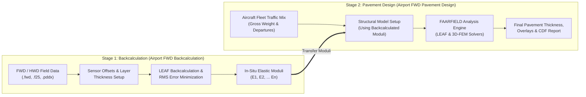

<div align="center">


# Airport FWD Data Analyzer

[](https://microsoft.com/windows)
[](https://dotnet.microsoft.com/download/dotnet-framework/net48)
[](NOTICE.md)
[](BUILD_NOTES.md)

</div>

**Airport FWD Data Analyzer** is a portable, unified engineering software suite designed for airport pavement evaluation, non-destructive Falling Weight Deflectometer (FWD/HWD) testing analysis, layer modulus backcalculation, and FAA-compliant airport pavement thickness and overlay design.

The suite brings together two industry-standard pavement evaluation engines behind a modern, high-DPI Windows launcher:

1. **Airport FWD Backcalculation** (powered by BAKFAA v3.4.4.0) — imports field deflection basins, configures multi-layer pavement cross-sections, and backcalculates layer elastic moduli using linear elastic theory.
2. **Airport FWD Pavement Design** (powered by FAARFIELD v2.1.2.0) — computes airport pavement thickness, overlay requirements, and life cycles using Cumulative Damage Factor (CDF) analysis in strict accordance with FAA Advisory Circular (AC) 150/5320-6G.

---

## Table of Contents

- [Key Capabilities](#key-capabilities)
- [Software Modules](#software-modules)
  - [1. Branded Launcher](#1-branded-launcher)
  - [2. Backcalculation Engine](#2-backcalculation-engine)
  - [3. Pavement Design Engine](#3-pavement-design-engine)
- [System Requirements](#system-requirements)
- [Quick Start & Usage](#quick-start--usage)
- [Step-by-Step Engineering Workflow](#step-by-step-engineering-workflow)
- [Repository Structure](#repository-structure)
- [Building the Launcher from Source](#building-the-launcher-from-source)
- [Integrity Verification](#integrity-verification)
- [Branding and Legal Notices](#branding-and-legal-notices)
- [Support](#support)

---

## Key Capabilities

- **Zero-Installation Portability**: Runs directly from the package folder without administrative installers or registry entries.
- **Unified Engineering Workflow**: Seamless transition from raw FWD/HWD field deflection data to evaluated layer moduli and finalized FAA runway/taxiway pavement designs.
- **Extensive Deflection Format Support**: Built-in specifications for Dynatest, KUAB, JILS, Foundation Mechanics, PDDX, and PaveTesting raw data files.
- **High-Performance Numerical Solvers**: Utilizes the FAA LEAF multi-layer elastic solver and 3D Finite Element Method (3D-FEM) engines for flexible and rigid pavement structures.
- **Comprehensive Aircraft Fleet Database**: Preloaded with hundreds of commercial, cargo, military, and general aviation aircraft configurations (wheel spacing, tire pressures, and gear loads).
- **Modern High-DPI Desktop Experience**: Clean, DPI-aware launcher (`PerMonitorV2`) optimized for standard 96 DPI and high-resolution laptop displays (125%, 150%, 200%).

---

## Software Modules

```
                    +-------------------------------------+
                    |      Airport FWD Data Analyzer      |
                    |      airport-fwd-data-analyzer.exe  |
                    +------------------+------------------+
                                       |
                +----------------------+----------------------+
                |                                             |
                v                                             v
+-------------------------------+             +-------------------------------+
|  Airport FWD Backcalculation  |             |  Airport FWD Pavement Design  |
|  (BAKFAA v3.4.4.0 Engine)     |             |  (FAARFIELD v2.1.2.0 Engine)  |
|                               |             |                               |
| - FWD / HWD data import       |             | - Flexible & Rigid Design     |
| - Deflection basin matching   |   Pass E-   | - FAA AC 150/5320-6G rules    |
| - LEAF backcalculation solver |  Moduli     | - Cumulative Damage (CDF)     |
| - Multi-layer modulus tuning  +------------>| - Aircraft Fleet Traffic Mix  |
| - Temperature corrections     |             | - Structural Overlay Analysis |
+-------------------------------+             +-------------------------------+
```

### 1. Branded Launcher
- **Executable**: `airport-fwd-data-analyzer.exe`
- **Configuration**: `airport-fwd-data-analyzer.exe.config`
- **Source**: `src/Launcher/`
- Serves as the central launchpad for all pavement engineering utilities. Built with modern typography, responsive visual styling, high-DPI scaling, and error-handled process launching.

### 2. Backcalculation Engine
- **Executable**: `Airport_FWD_Backcalculation/AirportFWD.Backcalculation.exe`
- **Engine Version**: 3.4.4.0
- **Primary Capabilities**:
  - Ingests single-drop and multi-drop deflection measurements across arbitrary sensor arrangements.
  - Multi-layer linear elastic backcalculation to determine in-situ elastic moduli ($E_1, E_2, \dots, E_n$) for surface, base, subbase, and subgrade layers.
  - Hardware-accelerated Direct2D / Direct3D interactive deflection basin charts.
  - Automated Root Mean Square (RMS) error minimization between measured and calculated deflection bowls.
  - Contextual help accessible via built-in `BAKFAA.chm`.

### 3. Pavement Design Engine
- **Executable**: `Airport_FWD_Pavement_Design/AirportFWD.PavementDesign.exe`
- **Engine Version**: 2.1.2.0
- **Primary Capabilities**:
  - FAA Federal Aviation Administration AC 150/5320-6G design methodology.
  - New flexible, rigid, and composite pavement design.
  - Asphalt concrete (HMA) and Portland cement concrete (PCC) overlay design over existing pavements using backcalculated moduli.
  - Full aircraft library: Boeing (737, 777, 787, etc.), Airbus (A320, A350, A380, etc.), Bombardier, Embraer, and military airframes.
  - CDF (Cumulative Damage Factor) subgrade strain and concrete slab stress evaluation.
  - Embedded documentation accessible via `Resources/FAARFIELD.chm`.

---

## System Requirements

| Component | Minimum Specification | Recommended Specification |
|---|---|---|
| **Operating System** | Windows 10 (64-bit, Version 1809+) | Windows 11 (64-bit) |
| **Runtime** | Microsoft .NET Framework 4.8 | Microsoft .NET Framework 4.8 |
| **Processor** | Dual-core 2.0 GHz x64 CPU | Quad-core 3.0 GHz+ x64 CPU |
| **Memory (RAM)** | 4 GB | 8 GB or higher (for 3D-FEM calculations) |
| **Storage** | 500 MB free disk space | 2 GB free disk space (for job files and logs) |
| **Display** | 1280 x 720 resolution | 1920 x 1080 resolution (100%–150% DPI scale) |

---

## Quick Start & Usage

### Running via the Launcher (Recommended)

1. Extract or clone the entire repository into a folder on your local drive (e.g., `C:\PavementTools\airport-fwd-data-analyzer`).
2. Double-click `airport-fwd-data-analyzer.exe` in the root folder.
3. Select **Open Backcalculation** or **Open Pavement Design** to start your engineering session.

> [!IMPORTANT]
> **Keep the package structure intact:** The application relies on relative paths to locate runtime dependencies, specification files, aircraft tables, and help manuals. Do not move executable files outside of their parent folders.

### Direct Execution of Standalone Engines

You can also launch each tool independently without the launcher:

- **Backcalculation**: Navigate to `Airport_FWD_Backcalculation/` and run `AirportFWD.Backcalculation.exe`.
- **Pavement Design**: Navigate to `Airport_FWD_Pavement_Design/` and run `AirportFWD.PavementDesign.exe`.

---

## Step-by-Step Engineering Workflow



1. **Data Ingestion**: Open Backcalculation and import raw deflection bowl data from your FWD or HWD device.
2. **Structural Model Setup**: Specify known pavement layer thicknesses from coring logs or construction records.
3. **Modulus Backcalculation**: Execute iteration until calculated deflections match measured deflections within acceptable tolerance (typically RMS error < 2–3%).
4. **Structural Evaluation**: Review backcalculated moduli for asphalt stiffening, base degradation, or subgrade moisture softening.
5. **Pavement & Overlay Design**: Open Pavement Design, input the backcalculated moduli into the layer structure, configure design aircraft movements, and compute required new or overlay thicknesses.

---

## Repository Structure

```
airport-fwd-data-analyzer/
│
├── airport-fwd-data-analyzer.exe        # Branded Windows launcher executable
├── airport-fwd-data-analyzer.exe.config # High-DPI and .NET 4.8 runtime activation policy
├── build_launcher.bat                   # Automated compilation batch script for launcher
│
├── src/
│   └── Launcher/                        # Complete C# source code for the launcher
│       ├── Program.cs                   # Application entry point
│       ├── LauncherForm.cs              # DPI-aware Windows Forms GUI implementation
│       └── Properties/
│           └── AssemblyInfo.cs          # Assembly metadata and version attributes
│
├── assets/
│   ├── airport-fwd-data-analyzer-logo.png # High-resolution suite artwork
│   └── app.ico                          # Application icon resource
│
├── Airport_FWD_Backcalculation/         # Portable Backcalculation suite (BAKFAA v3.4.4.0)
│   ├── AirportFWD.Backcalculation.exe   # Backcalculation executable
│   ├── BAKFAA.chm                       # Built-in help and reference manual
│   ├── Data/                            # Deflection specification formats (JILS, KUAB, etc.)
│   ├── Defaults/                        # Default materials, hatches, and configs
│   └── *.dll                            # LEAF engine, SharpDX, and Telerik dependencies
│
├── Airport_FWD_Pavement_Design/         # Portable Pavement Design suite (FAARFIELD v2.1.2.0)
│   ├── AirportFWD.PavementDesign.exe    # Pavement design executable
│   ├── Defaults/Aircraft/               # Preloaded aircraft library and characteristics
│   ├── Defaults/Materials/              # Material definition libraries and hatches
│   ├── Resources/FAARFIELD.chm          # FAA Pavement Design comprehensive manual
│   └── *.dll                            # FEA mesh, FEM solver, LEAF, and reporting libraries
│
├── BUILD_NOTES.md                       # Detailed engineering build log and dependency audit
├── NOTICE.md                            # Third-party notices and license disclosures
├── README.md                            # Suite overview and user guide (this document)
└── SHA256SUMS.txt                       # Cryptographic SHA-256 validation manifest
```

---

## Building the Launcher from Source

The launcher is written in C# and targets .NET Framework 4.8. It does not require Visual Studio to be installed; it compiles directly using the built-in Windows C# compiler (`csc.exe`).

### One-Click Build

Open Command Prompt or PowerShell in the repository root and run:

```bat
build_launcher.bat
```

### Manual Compilation Command

```cmd
%SystemRoot%\Microsoft.NET\Framework64\v4.0.30319\csc.exe /target:winexe /platform:anycpu /optimize+ ^
  /win32icon:assets\app.ico ^
  /resource:assets\airport-fwd-data-analyzer-logo.png,AirportFwdDataAnalyzer.logo.png ^
  /out:airport-fwd-data-analyzer.exe ^
  src\Launcher\Program.cs ^
  src\Launcher\LauncherForm.cs ^
  src\Launcher\Properties\AssemblyInfo.cs
```

---

## Integrity Verification

To verify that files have not been modified or corrupted, check their SHA-256 hashes against `SHA256SUMS.txt`:

### Using PowerShell
```powershell
Get-FileHash airport-fwd-data-analyzer.exe -Algorithm SHA256
```

### Batch Verification
```powershell
Get-Content SHA256SUMS.txt | ForEach-Object {
    $expectedHash, $file = -split $_
    if (Test-Path $file) {
        $actualHash = (Get-FileHash $file -Algorithm SHA256).Hash.ToLower()
        if ($actualHash -eq $expectedHash) {
            Write-Host "OK: $file" -ForegroundColor Green
        } else {
            Write-Host "FAILED: $file" -ForegroundColor Red
        }
    }
}
```

---

## Branding and Legal Notices

- **Airport FWD Data Analyzer** name, launcher implementation, logos, packaging, and accompanying documentation are **Copyright © 2026 Sahil Yadav**.
- The underlying engineering computational engines, original source components, standard manuals, and technical formulations incorporate tools originally authored by the Federal Aviation Administration (FAA). All original notices, trademarks, and third-party rights are fully retained. See [NOTICE.md](NOTICE.md) for full attribution details.

---

## Support

For bug reports, technical inquiries, or assistance:

- **Repository**: [github.com/sahilyadav-01/airport-fwd-data-analyzer](https://github.com/sahilyadav-01/airport-fwd-data-analyzer)
- **Email**: [skonetechsupport@gmail.com](mailto:skonetechsupport@gmail.com)
